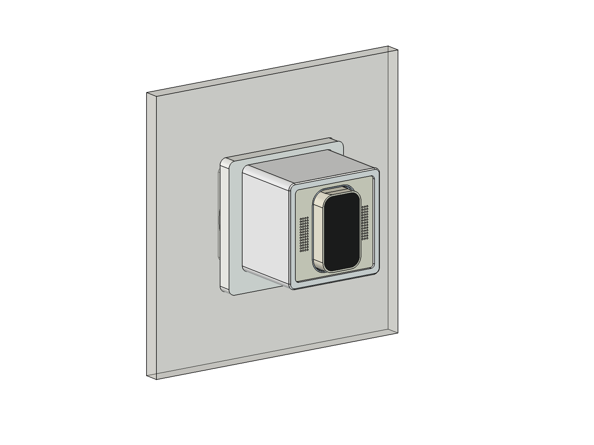
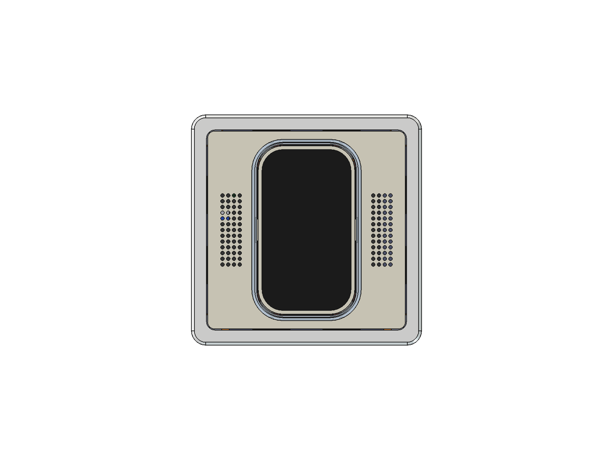
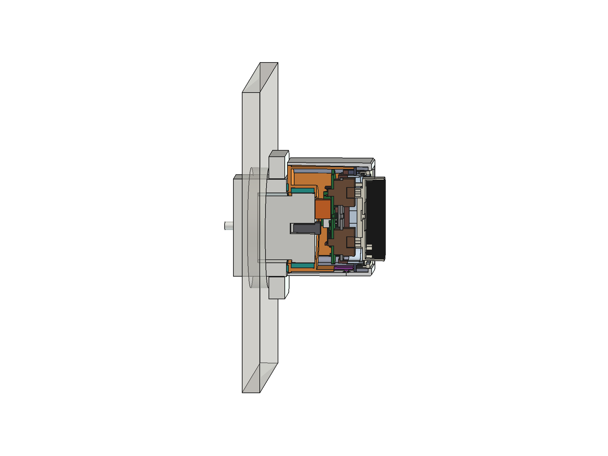
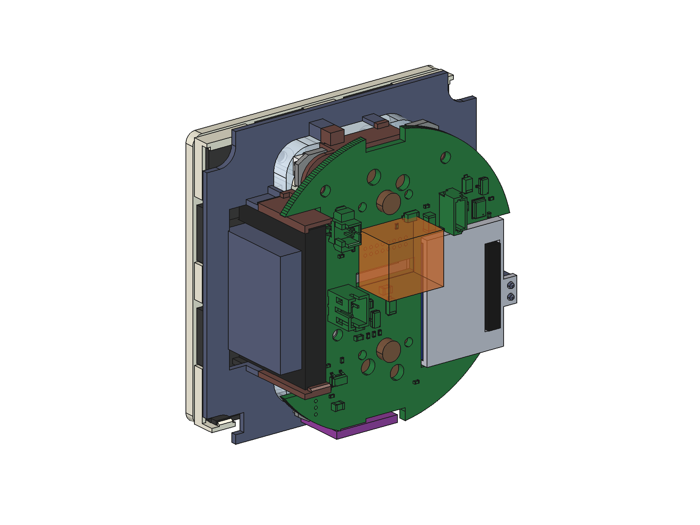
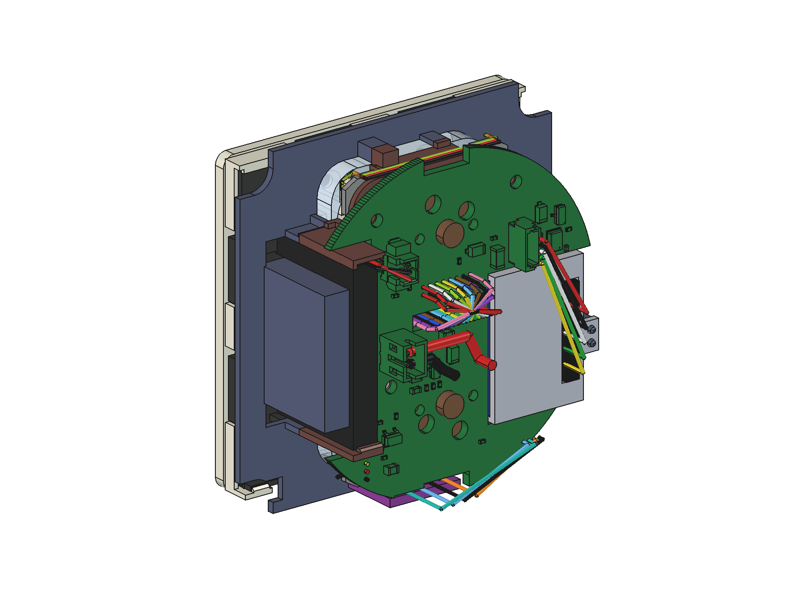

# Hardware

Parametric FreeCAD scripts, the same method as [Klingelbox](https://github.com/aikos-home/intercom):
one file holds every dimension, generators read it, `validate()` checks the fit before anything is
printed. Licence: [CERN-OHL-P-2.0](../LICENSES/CERN-OHL-P-2.0.txt).

**→ Build it: [BUILD.md](BUILD.md)** · **print it: [print/README.md](print/README.md)** · **the housing:
[docs/plug-in-housing.md](docs/plug-in-housing.md)**

*RoomKey v0.12 (WIP, not printed in this revision, nothing certified): one device that plugs into a SCHUKO socket —
touch key on two MX switches, glow ring, speaker, mic, presence radar, humidity sensor — in a 64 × 64 housing, 55 mm
from the key glass to the socket face. 230 V stays inside an unmodified, certified USB charger in the housing; RoomKey
takes 5 V. Real FreeCAD screenshots, made by [`cad/view_plug.py`](cad/view_plug.py) from the same scripts that write
the print files.*

## How this hardware is made — one person and Claude

Everything in this folder comes out of a loop between **one person** (the owner: parts, printer, hands, decisions) and
**Claude** (Anthropic's AI, working in Claude Code: CAD scripts, arithmetic, checks, documentation). Together that covers
the jobs of a small product design team — industrial design, mechanical CAD, tolerance analysis, print engineering,
technical writing and design review. **In practice the owner runs a one-person product design studio.**

**One turn of the loop** (often the same evening, from "this is too tight" to a new print file):

1. **Say it from the bench, in plain words.** Usually one sentence and a phone photo: *"the board fits perfectly but I
   can hardly get it out"*, *"we have two switches — let the key rock so each can be pressed alone, and a press in the
   middle must still do something"*, *"everything goes into one box, except the power supply"*.
2. **Measure the real part.** Calliper values and photos of every module that goes in (speaker, radar, amplifier,
   sensors, the touch board, the wall frame). Each number lands in a parameter file with a tag — **[MEAS]** measured,
   **[DS]** data sheet, **[FREE]** design choice, **[TBD]** assumption — so it is always clear what is known and what is
   a guess. When a value cannot be measured, Claude researches it (vendor drawings, data sheets) and marks it [TBD].
3. **Change the parameters, not a drawing.** Claude edits the parameter files and the FreeCAD generator scripts. No part
   is drawn by hand: every solid, drawing and screenshot is rebuilt from code, so a 0.4 mm change ripples through
   all parts at once.
4. **Let the checks say no before the printer does.**
   - `validate()` runs about 100 rules (0 errors before anything is exported).
   - Every pair of parts is checked for collisions at rest, key pressed, wobbled and pulled, in the housing on the
     socket.
   - Every printed part must be one solid, and (except the key shell) print without supports: no large surface may
     face the bed in the air.
   - Minimum wall thickness of the printed parts, and clearances reported in millimetres.
   - For the kit, all 41 wires are routed in 3D and checked against the parts; their cut lengths come out as a table.
5. **Hand over print files.** STL per part in print orientation, plus a short print sheet (material, nozzle, layers,
   supports, order) and a wiring sheet. All on one bed of a Bambu Lab A1, PETG.
6. **Print, fit, report back.** The owner prints, tries the real parts and sends the result — which is the next step 1.
   The checks do not catch everything. At the first kit assembly the rocker key simply fell out: the stem forks had been
   sized from a clearance dimension and clamped nothing. The next turn added a catch to the collar, plus a CAD check that
   pulls the key out and must fail to get it free. One turn later the owner dropped the rocker altogether (v0.9).
7. **Review.** Larger revisions go through independent adversarial review rounds: fresh AI reviewers try to break the
   design, and every finding gets a fix or a stated assumption with a test and a fallback
   ([review log](reviews/insert-v0-review-log.md)).

**Rules that hold in every turn.**
- **Safety:** the parts here are extra-low voltage (SELV) only. Everything on 230 V is a certified, unmodified device
  (the plug-in USB charger) — Claude does not design mains parts, even when asked.
- **The owner decides.** Claude proposes; when a proposal is wrong, it is dropped. Example: Claude moved the sensors into
  a second box to make room; the owner said *"everything in one box"*. The result, kit v0.7, was better: the radar
  looks through the left wing of the plate, the mic hears through a sound tube. Later the owner made RoomKey a plug-in
  device only, then asked for the housing to shrink to the smallest size that works (64 × 64).
- **WIP is labelled WIP.** Nothing here is built to a standard or certified. Untested features say so.
- **Interfaces are agreed, not guessed.** The pin plan of the kit was checked against the RoomKey firmware by the
  firmware side before it went into this repository.

| | |
|---|---|
|  |  |
| *The front: plate 55 × 55 with speaker and mic perforation, touch key with glow ring, a 4.2 mm border.* | *Section x = 0: key, front stack, hub PCB, the key wires' loop, USB plug, charger in its sleeve, socket.* |
|  |  |
| *PCB build from behind: hub PCB, the radar in its cage in the hub plane, speaker, the two key switches.* | *The wires the hub PCB leaves (key, LEDs, radar, speaker, sensor, 5 V), routed in 3D and checked against the parts.* |

| File | What |
|---|---|
| [`cad/roomkey_params.py`](cad/roomkey_params.py) | measured parts (touch board, MX, speaker, radar, sensors), tagged [DS] · [MEAS] · [FREE] · [TBD] |
| [`cad/insert_params.py`](cad/insert_params.py) | **every dimension of the RoomKey**: front stack, kit (§7), plug-in housing (§8); `python3 cad/insert_params.py` validates |
| [`cad/insert_lib.py`](cad/insert_lib.py), [`make_key_module.py`](cad/make_key_module.py), [`make_front.py`](cad/make_front.py) | front-stack parts + checks (key pressed, wobbled, pulled; MX2 floating) |
| [`cad/kit_lib.py`](cad/kit_lib.py), [`make_kit.py`](cad/make_kit.py), [`wiring_pcb.py`](cad/wiring_pcb.py), [`wiring_lib.py`](cad/wiring_lib.py) | **the electronics in two builds** (hub PCB / self-wired) from one codebase, every wire routed in 3D |
| [`cad/plug_lib.py`](cad/plug_lib.py), [`make_plug.py`](cad/make_plug.py) | **the plug-in housing v0.4** (64 × 64): resin skin, printed tunnel + columns, lid with charger sleeve, TPU rings |
| [`cad/view_kit.py`](cad/view_kit.py), [`render_kit.py`](cad/render_kit.py), [`view_plug.py`](cad/view_plug.py) | open the kit / the housing in the FreeCAD GUI (coloured, grouped) and render the images in [`docs/img/`](docs/img/) |
| `pcb/roomkey-hub/` | the hub PCB (KiCad): rev D for housing v0.4 is in progress and lands here when it is done |
| [`../tools/insert_wallcheck.py`](../tools/insert_wallcheck.py) | minimum wall thickness of the printed parts (FreeCAD's bundled python) |
| [`reviews/insert-v0-review-log.md`](reviews/insert-v0-review-log.md) | pre-mortems and adversarial reviews of the earlier wall-insert design (history) |
| `models/*_print.stl` | ready to slice · `models/*.step` for editing |

## Status (2026-10-31)

**WIP.** One RoomKey (no variants), fixed plate, the two MX under the key are the only buttons; built only as the
plug-in device. CAD closes in all checked states for both builds (0 collisions; key pressed, wobbled ±1.5°, pulled;
MX2 at the ends of its floating socket; the housing's lid goes in with the sensor on it); `validate()` 0 errors. Not
printed in this revision: the housing v0.4, the radar cage, the LED holder. Waiting for: hub PCB rev D (outline, radar
window, J1), the resin moulds for the skin and the plate face, the grip-ring coupons on the real charger.
