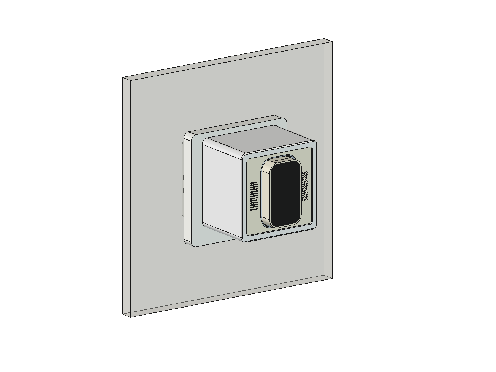
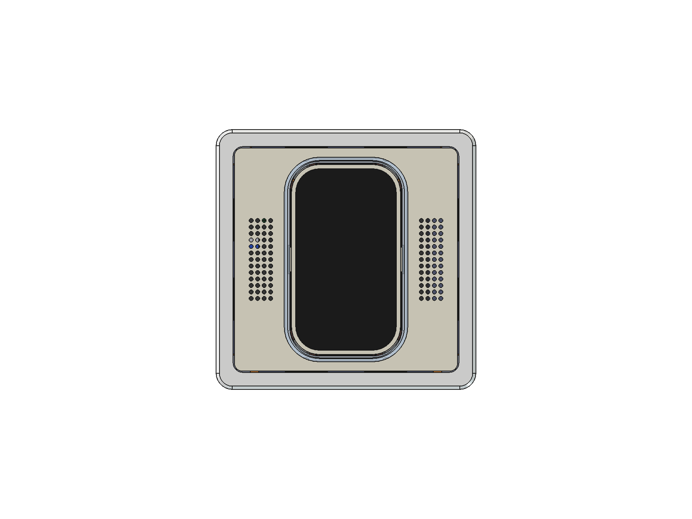
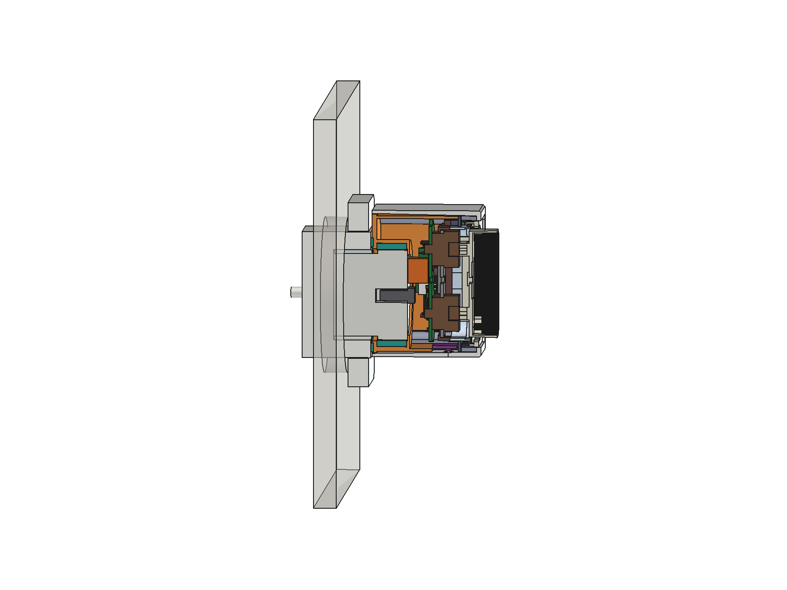
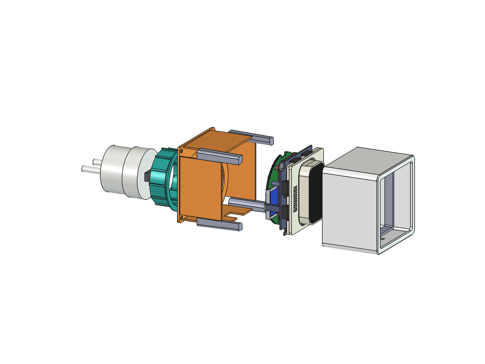
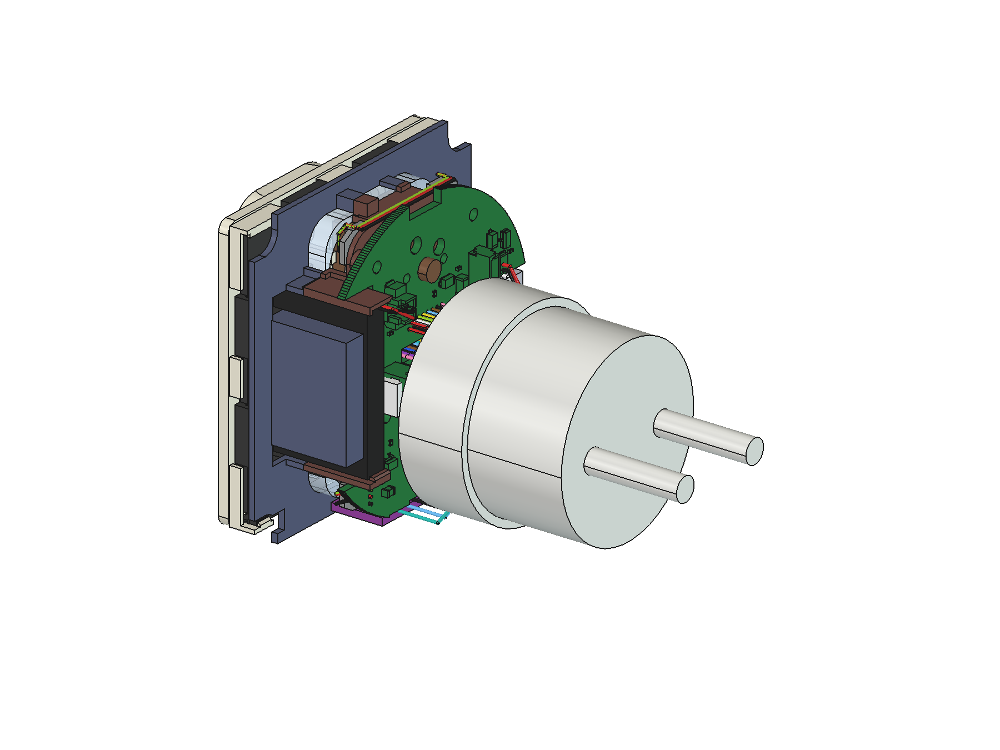
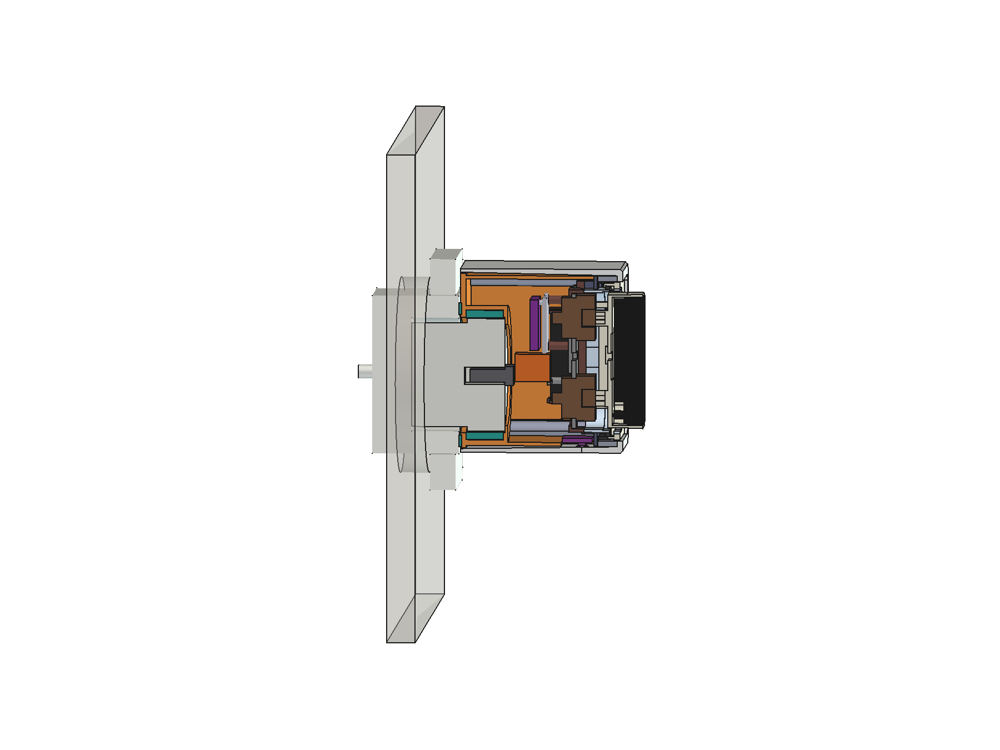

# RoomKey plug-in housing ("Steckdosen-RoomKey") — v0.4

> **DRAFT / WIP (2026-10-31, branch `kit-pcb`). AI-assisted design. Not printed, not cast, not tested, nothing certified.**
> - RoomKey is built **only** as this plug-in device (owner, 2026-10-31). It stays a **SELV-only (class III) device**.
> - 230 V exists only **inside an unmodified, certified plug-in USB charger**. The housing only holds that charger;
>   nobody opens it, wires it or changes it.
> - The charger's own plug goes straight into the socket through the housing's back plate. No mains wiring in this
>   repository, no mains parts from it.

The owner's brief: the whole RoomKey as **one device that plugs into a SCHUKO socket**, as flat on the wall as possible,
with the RoomKey's front (plate 55 × 55, key, glow ring). v0.3 was the 1-gang frame size (80.5 × 80.5). v0.4 (owner,
2026-10-31): **as small as possible**, so the neighbouring sockets of a power strip stay usable, and **less deep**.

- **Outline 64 × 64** (≤ 75 × 75 allowed): a 4.2 mm border round the plate. The humidity sensor no longer fits under a
  frame border and moves into the bottom wall.
- **Depth package B:**
  - the device sits **5 mm above the socket centre**, so the charger's USB plug lies below the key wires' loop instead
    of behind it;
  - a slim bare USB-A plug;
  - the radar's header pins are cut short and (PCB build) the radar sits **in the hub plane**.
- **Glass to socket face: 55.0 mm (PCB build, v0.3: 62.3), 64.0 mm (self-wired build, v0.3: 68.0).**
- **Front for casting:** the visible skin is a resin casting (the resin thread makes the moulds); everything functional
  behind it is printed and glued in.

| | |
|---|---|
|  |  |

## Parts

| | part | made as | notes |
|---|---|---|---|
| G1 | skin (`plug-<build>_skin`) | **resin casting** (a PETG print for the first fit, front down) | 64 × 64, R 4 corners, 45° × 0.8 front edge. Front border 2.0 thick, 1.0 proud of the plate face, opening 55.6 with R 2.3 corners. Walls 2.2 at the front, **1° draft inside** towards the open back. Nothing hangs from the border's underside, no inserts, the back edge is the free casting face. Vents + light window in the bottom wall |
| G1 | tunnel (`plug-<build>_tunnel`) | PETG, front down | glued into the skin against its border; the insert's locating rims sit in it (0.1), its back end (d 7.7) stops the insert's flange |
| G1 | 4 columns (`plug-<build>_column`, print 4) | PETG, back down | corner blocks with an M3 heat-set insert each (Ø4.0 × 6.5 from the back), glued into the skin's corners |
| G2 | lid (`plug-<build>_box`) | PETG V-0, back down | back plate inside the skin, flush with its back edge (invisible from outside); charger sleeve with a front lip and the grip ring's seat; 4 side walls that press the flange forward (corners cut round the columns); the humidity sensor's window in the bottom wall; 4 × M3 countersunk into the columns |
| R1 | grip ring (`plug_grip_1…3`), TPU 95A | standing | flex ring in G2's sleeve: 12 inner ribs, 12 outer standoffs between them, the tube bends between the standoffs. Coupons: ribs 0.3 / 0.5 / 0.7 into the charger, marked by 1 / 2 / 3 notches |
| R2 | foot ring (`plug_foot`), TPU 95A | flat | Ø42/50 × 1.0 in a groove of G2's back face, round the charger's axis; it just touches the socket face |
| P | probe sleeve (`plug_probe`), coupon | back down | G2's sleeve on a Ø52 disc: try R1 1–3 with the charger before printing G2 |
| — | insert | the kit (either build) | chassis flange 59.2 × 59.2 with corner notches |

**Glue joints (carrier ↔ skin):** 0.15 per side, all on faces that follow the skin's draft. The columns are aligned by
the lid: screw them onto G2 first, put glue on their two outer faces, push G2 with the columns into the skin, let it cure.
G2 comes off again for service (4 screws); the columns stay in the skin.

## Stack-up (depth d behind the plate front)

| d (mm) PCB build | self-wired | what |
|---|---|---|
| −8.0 | −8.0 | key glass |
| −1.0 … 1.0 | same | skin front border |
| 1.0 … 7.7 | same | tunnel (rims inside it from d 3.5) |
| 7.8 … 9.0 | same | insert flange: tunnel end in front (0.1 play), G2's side walls behind |
| 20.3 … 21.9 | — | hub PCB and, in its radar window, the LD2410C (antenna face on the hub's front plane) |
| 30.81 | 36.5 | key wires' U-loop, back end (PCB: it turns up, the USB plug sits below it) |
| 28.0 … 31.0 | 37.0 … 40.0 | slim USB-A plug body (solder cups) |
| 31.0 | 40.0 | charger front face (on the sleeve's lip) |
| 46.4 | 55.4 | housing back face: 0.6 in front of the socket face, the foot ring bridges it |
| 47.0 | 56.0 | socket face |

**Glass → socket face 55.0 / 64.0 mm**, skin front → back face 47.4 / 56.4 mm. The device's centre is 5 mm above the
socket's. About 150 / 160 g with the centre of mass ≈ 18 mm in front of the socket face: ≈ 0.03 N·m on the socket (IEC
62368-1 §4.7 allows 0.25 N·m for direct plug-in equipment).

## Interior and interfaces

- **Behind the flange:** a square of ±28.0 (0.45 to G2's side walls), the corners kept free for the columns
  (circle r 3.2 round (±26.8, ±26.8) and everything outside it).
- **Hub PCB (rev D, PCB thread):** contour inside that square, corner notches r 3.9; the radar window (x < −7.86,
  y −18.4 … 6.2, open to the −x edge); a notch at the bottom edge (x −4.3 … 9.84, y ≤ −25.87) that the humidity sensor
  passes when G2 goes in; J1 as a side-entry JST PH (mouth towards −x) with a lane free of parts for its lead. Until rev D
  exists, the CAD cuts this outline into the rev C board (`ROOMKEY_HUB_REV_D=1` reads a rev D board unchanged).
- **Radar cage (PCB build):** walls on three sides, a back plate with a slot for the cut-short header pins, front lips
  at the board's short ends; the board slides in from +x, the hub window's edge stops it. Its ear sits on the chassis
  blade (2 pins).
- **Humidity sensor:** SHT31-D (self-wired) or the planned sensor tail (SHT40 + VEML6030, PCB build) flat in G2's bottom
  wall, chip side down over 4 vents Ø1.5 in the skin; a Ø2.0 light window beside it (filled clear) for the VEML6030. The
  board rests on G2's wall at its two ends; a dot of hot glue holds it.

## Charger

**revolt PX-8884** (Pearl, EAN 4022107346085, REV4 2024): 5 V 2.1 A USB-A, contour plug, class II, CE. Measured by the
owner (2026-10-31): front part Ø39.25, the part in the socket recess Ø36.17, body 32.3 long without the pins, 16.0 out
of the owner's socket; USB-A opening 14 × 5.95, horizontal, centred on the front face. The step between the two
diameters sits ≈ 13.0 behind the face (photo, ±0.5): the grip ring grips only the thick part. The shop lists no GS / TÜV
mark (CE only).

## Materials

| part | material | why |
|---|---|---|
| G1 skin | resin (the resin thread's choice); PETG for a first fit | visible face, cast in silicone moulds without vacuum or pressure |
| G1 tunnel + columns, G2, P | PETG UL94 V-0, black | hidden; G2 touches the charger |
| chassis, switch plate, radar cage / back carrier | PETG V-0, black | |
| plate, key, collar | as before (plate face cast in resin by the resin thread, or printed) | |
| R1, R2 | TPU 95A | holds the charger by spring force; protects the socket face |

On a two-nozzle printer (Bambu X2D) G2 in PETG and R1 in TPU print in one job: R1 is caught in its seat, no bond needed.

## Assembly

1. Tunnel into the skin: glue on its outer faces, pushed against the border's underside.
2. M3 heat-set inserts into the 4 columns from the back.
3. Insert (kit, either build, without the plate) from behind into the skin: rims into the tunnel, flange onto its end.
4. Humidity sensor into G2's window, chip side down; dot of hot glue; wires to J9 (PCB build) / the touch-board pins
   (self-wired build).
5. USB-A plug: solder the two leads (VBUS left cup, GND right cup, looking from the room — check the plug bought).
   PCB build: into J1's PHR plug; self-wired build: to the splice points beside the amplifier.
6. Grip ring into G2's sleeve; foot ring into the groove. Plug the USB plug into the charger, press the charger into
   the grip ring from behind until its face rests on the lip.
7. Columns onto G2 (4 screws), glue on the columns' outer faces, G2 into the skin from behind. Let it cure.
8. Plate onto the deck from the front.

| | |
|---|---|
|  |  |
| *Skin, carrier and lid hidden: the insert, the USB plug and its two leads, the charger.* | *Self-wired build: its key-wire loop rolls down behind the back carrier, so the charger sits 9 mm further back.* |

## Open

- Print P with R1 1–3 and keep the ring that holds the charger firmly but still lets it be pressed in by hand.
- The resin thread decides the skin's wall thickness and draft for its mould (the CAD takes them from `PLUG_SKIN`).
- Hub rev D (PCB thread): outline, radar window, bottom notch, J1 side-entry; then the sensor tail.
- Temperature reading: the charger warms the housing; the sensor sits at the front of the bottom wall, as far from it
  as the housing allows — compare against a reference thermometer for a day.
- A socket with a deeper recess (CEE 7/3 allows ≈ 17.5) lets the charger in further: the foot ring touches before the
  charger is fully home.

## Files

`hardware/cad/insert_params.py` §8 (`PLUG_*`, `plug_depths(build)`, `plug_in_half()`, `plug_rh()`), `plug_lib.py`
(`use_build()`), `make_plug.py` (headless build + checks for both builds: collisions at rest and key pressed, G2's way
in, gaps, mass and moment), `view_plug.py` (FreeCAD GUI, `ROOMKEY_BUILD` = pcb / discrete; `PLUG_RENDER=1` renders the
images). Outputs in `hardware/models/plug*`: `plug-<build>_skin`, `_tunnel`, `_column`, `_box`, `plug_grip_1…3`,
`plug_foot`, `plug_probe`, each `.step` + `_print.stl`; `plug-<build>-v0.4_assembly.step`, `_check.json`.
