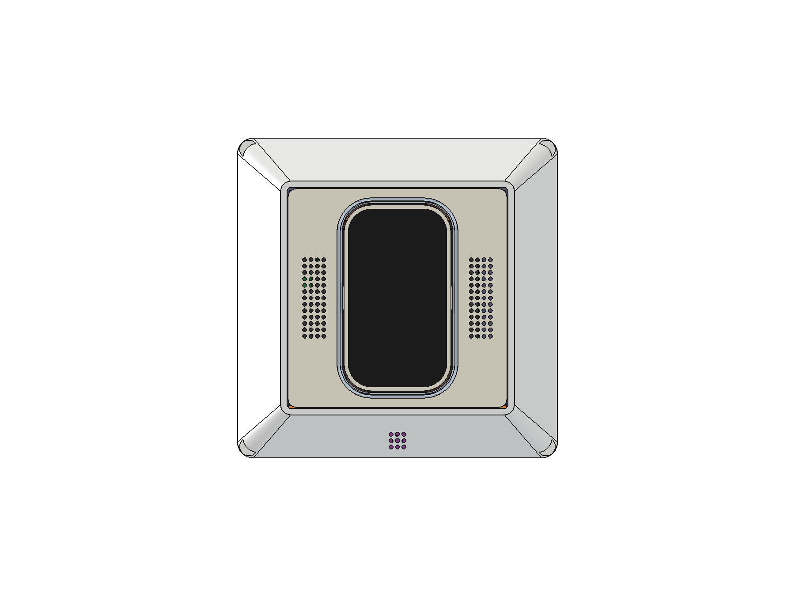
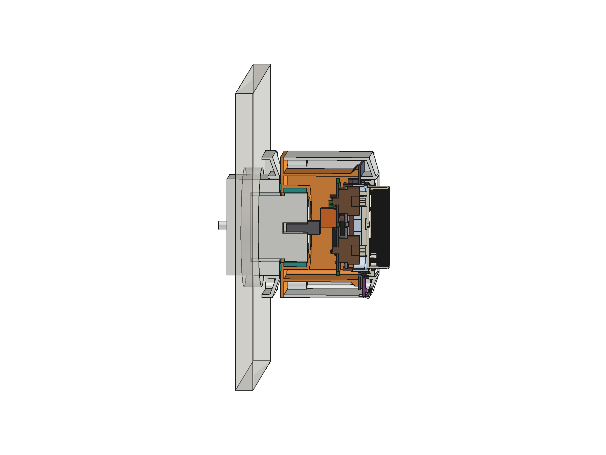
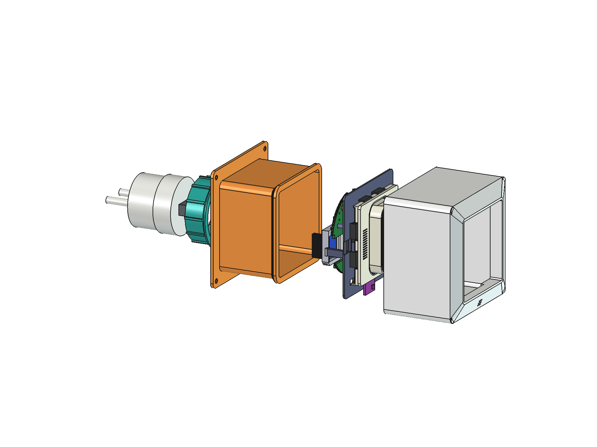
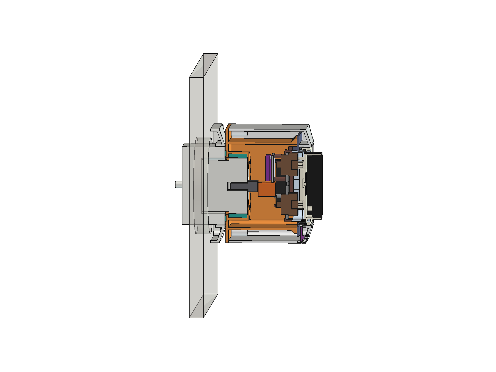

# RoomKey plug-in housing ("Steckdosen-RoomKey") — v0.3

> **DRAFT / WIP (2026-10-31, branch `plug`). AI-assisted design. Not printed, not tested, nothing certified.**
> - The RoomKey stays a **SELV-only (class III) device**. 230 V exists only **inside an unmodified, certified plug-in
>   USB charger**. The printed housing only holds that charger; nobody opens it, wires it or changes it.
> - The charger's own plug goes straight into the socket through the housing's back plate. No mains wiring in this
>   repository, no mains parts from it.

The owner's brief: the whole RoomKey as **one device that plugs into a SCHUKO socket**, **as flat on the wall as
possible**, with **the same front as the flush-mounted RoomKey**. Chosen: one 1-gang frame size (80.5 × 80.5, Jung
AS 500), **charger behind** the RoomKey; the charger was left to the design ("pick one").
- v0.2: a TPU grip ring holds the charger, a TPU foot ring rests on the socket face, the corner screws go into heat-set
  inserts.
- v0.3 (2026-10-31): the charger as the owner measured it; the grip ring **flexes** instead of being squeezed; G1 and G2
  for **both kit builds** (hub PCB / self-wired); on a two-nozzle printer (Bambu X2D) G2 and the TPU grip ring print as
  one part.

## Stack-up (depth d behind the plate front)

| d (mm) PCB build | self-wired | what | why |
|---|---|---|---|
| −8.0 | −8.0 | key glass | the unchanged key stack (8 mm proud) |
| −1.0 | −1.0 | frame rim | practice frame, Jung AS 500 profile |
| 7.7 / 7.8–9.0 | same | G1 frame tunnel end / insert flange | G1 holds the flange from the front (0.1 play) |
| 9.0 | 9.0 | G2 cup rim | presses the flange from behind: **no box screws** |
| 30.81 | 36.5 | key wires' U-loop, back end | deepest insert part on the axis (PCB: `loop_up()`; self-wired: `LOOP_D1`, the loop rolls behind the back carrier) |
| 31.31–38.31 | 37.0–44.0 | USB-A plug body | 0.5 behind the loop; shell 12 deep in the charger's port |
| 38.31 | 44.0 | charger front face | rests on the sleeve's front lip |
| 38.71–51.71 | 44.4–57.4 | TPU grip ring | 12 ribs on the charger's thick front part (13.0 long) |
| 53.71 | 59.4 | housing back face | 0.6 in front of the socket face: the housing never holds the charger out of the socket |
| 54.31 | 60.0 | socket face | the TPU foot ring (Ø42/50, in a 0.4 groove) just touches it; charger 16.0 out, 16.3 in the recess |

**PCB build: 62.3 mm from the key glass to the socket face** (54.7 from the frame rim to the housing's back face),
**self-wired build: 68.0 mm** (60.4). On a Jung AS 500 SCHUKO socket (face ≈ 10 mm in front of the wall) the key glass
is ≈ 72 / 78 mm from the wall. 182 / 187 g, centre of mass 22 / 25 mm in front of the socket face → 0.040 / 0.046 N·m on
the socket (IEC 60950-1 §4.3.6 / IEC 62368-1 §4.7 allow 0.25 N·m for direct plug-in equipment).
v0.2 assumed the charger stood 14 mm out of the socket (Pearl's text); it stands 16.0 out → +2 mm.

## Charger

**revolt PX-8884** (Pearl, EAN 4022107346085, REV4 2024): 5 V 2.1 A USB-A, contour plug, class II, CE. Measured by the
owner (2026-10-31): front part **Ø39.25**, the part in the socket recess **Ø36.17** (earth-clip grooves at 12 and
6 o'clock, small rails at 3 and 9), body **32.3** long without the pins, **16.0** out of the owner's socket; USB-A
opening **14 × 5.95**, horizontal, centred on the front face (F 17 / G 12.8 → centre +0.18 / −0.35, within what
calipers read on a round rim). From the owner's photo: the step between the two diameters sits ≈ 13.0 behind the face
(±0.5) — the grip ring grips only the thick part. The shop lists no GS / TÜV mark (CE only).

## Parts

| | part | print | notes |
|---|---|---|---|
| G1 | frame + side walls (`plug-<build>_shell`) | back down, supports **inside** (frame face, tunnel) | frame tunnel lengthened to d 7.7 = flange stop, open at the bottom centre for the SHT31-D; 4 corner bosses Ø8, each with an M3 heat-set insert (hole Ø4.0 × 6.5 from the back, Ø3.2 beyond for the screw tip) |
| G2 | box (`plug-<build>_box`) | back down, no supports (widest ceiling 8.0: the foot ring's groove) | back plate 2.0 with the foot ring's groove; charger sleeve with a front lip and the grip ring's seat (Ø45.25, between a front step and the back plate, whose Ø40.25 hole lets the charger through); square cup (inner 59 × 59) whose rim backs the flange; PCB build: notch for the radar's plug |
| R1 | grip ring (`plug_grip_1…3`), TPU 95A | standing, back end down | flex ring Ø45.05 × 13: tube 1.6, 12 inner ribs (1.5 wide) and 12 outer standoffs halfway between them, so the tube bends between the standoffs. Three coupons: ribs 0.3 / 0.5 / 0.7 into the charger, marked by 1 / 2 / 3 notches in the back end |
| R2 | foot ring (`plug_foot`), TPU 95A | flat | Ø42/50 × 1.0 in the groove: on any central plate, clear of the recess |
| P | probe sleeve (`plug_probe`), coupon | back down | G2's sleeve on a Ø52 disc of its back plate: try R1 1–3 with the charger before printing G2 |
| — | insert | unchanged kit (either build) | the box screws and load plates are not used |

4 × M3 × 10 countersunk (ISO 10642; × 12 also fits) through the back plate into the inserts — hidden on the socket.
G2, P and R1 share one print frame (the back face on the bed): loaded together as one object of several parts, R1 sits
in its seat; loaded alone, the slicer drops it onto the bed.

**Why the grip ring flexes (v0.3):** v0.2's tube lay in its seat all round, so its ribs could only be squeezed. TPU 95A
(E ≈ 10–25 MPa) squeezed 0.2 mm over 12 ribs × 13 mm needs several hundred newtons (estimate): the charger would not go
in by hand. Between standoffs 30° apart the 1.6 mm tube is a short beam: 0.3–0.7 mm of rib travel gives ≈ 15–55 N of
hold (estimate, friction 0.5) — enough to pull the charger out of the socket with the housing. The coupons decide.

## Materials (recommendation 2026-10-27; printers: Bambu A1, from 2026-10-31 also the two-nozzle Bambu X2D)

| part | material | why |
|---|---|---|
| G2 box + charger sleeve, P | **PETG UL94 V-0**, black (Prusament PETG V0 Jet Black; Spectrum PET-G FR V0) | touches the charger; hidden; prints like PETG (230 °C / 80 °C) |
| chassis (3), switch plate, radar tray / back carrier | PETG V-0, black | as insert-design §10 already demands for the chassis |
| G1 frame + shell | ivory PETG from the plate's spool (or PETG V0 Natural if its shade matches) | visible, must match the plate; the charger does not touch it |
| plate, key, collar | as before (ivory + black core + natural glow rim, PETG, AMS); collar optionally clear PCTG | the glow rim must fuse with the plate → PETG |
| R1 grip ring, R2 foot ring | TPU 95A | holds the charger by spring force (ribs in brittle V-0 PETG break or relax); protects the socket face |

**Two-nozzle print (X2D):** G2 in PETG V-0 and R1 in TPU 95A in one job (the TPU nozzle is fed through a Bowden tube:
95A works, softer TPU is harder to feed). R1 is caught between the front step and the back plate, so the part needs no
bond between PETG and TPU. The same for the coupons: P with R1 1, 2 and 3. R2 stays a separate print: it stands 0.6 out
of the back face, which is the face on the bed. Fit values (PLUG_FIT 0.3, the insert holes) are free fits; the insert's
tight fits were tuned on the A1 with the 0.2 nozzle — print the insert there, or run its coupons on the X2D first.

The four corner screws go into M3 heat-set inserts (V-0 PETG is more brittle than plain PETG). The housing runs ≈ 5–10 K
above room temperature (≈ 1.4 W inside), so PETG (Tg ≈ 80 °C) has margin; PLA (Tg ≈ 55–60 °C) creeps at the press fit
and the screws. Not used: PLA, carbon/metal/graphite fills (conductive beside the plug pins, they damp the 24 GHz radar
and Wi-Fi), wood/stone fills, ABS/ASA/PC on the open A1 (warping). Bambu PC FR (V-0, also white) would be the best
material on the enclosed X2D; with TPU in the same job a hot chamber softens the TPU, so PETG V-0 stays. Prusament's UL
card covers prints on Prusa printers only: on Bambu printers the parts are V-0 material, not certified parts.

## Assembly

1. Four M3 heat-set inserts into G1's corner bosses from the back (soldering iron with an insert tip, PETG ≈ 230 °C),
   flush or 0.1 below the surface so G2 sits flat.
2. Grip ring: printed in G2 (X2D) — or, printed alone, squeeze it oval and push it through the back plate's hole until
   it snaps into its seat. Foot ring into the groove on the back face.
3. Kit insert (without the plate) from behind into G1: its rims go into the frame tunnel, the flange onto the stop.
4. SHT31-D into its pocket under the frame's bottom border, plug it into J9 (PCB build) / wire it (self-wired build).
5. Solder the USB-A plug's VBUS and GND (2 × 0.5 mm²): PCB build to hub J1 (5V 65 mm, GND 55 mm cut); self-wired build
   to the splice points beside the amplifier (5V 45 mm, GND 55 mm), in place of the lab supply's pair.
6. Plug it into the charger; press the charger into the grip ring from behind until its face rests on the lip (the
   wires fold into the cup).
7. G2 into G1 from behind, 4 screws. Plate onto the deck from the front.

### Self-wired build

Its key-wire loop rolls down behind the back carrier to d 36.5 (PCB build 30.81), and its amplifier sits on the axis
side of the carrier, so the charger moves 5.7 mm back: G1 and G2 are 5.7 mm longer, the TPU rings are the same.

## Open

- Print P with R1 1–3 and keep the ring that holds the charger firmly but still lets it be pressed in by hand; the
  step position (13.0 from the photo) decides how much of the ring grips.
- The radar's plug (PCB build) ends 0.19 mm beside the charger's front edge (the real edge is rounded): check with the
  real charger.
- The housing's back face stands 0.6 off the socket face because the charger stood 16.0 out of the owner's socket. A
  socket with a deeper recess (CEE 7/3 allows ≈ 17.5) lets the charger in further → the foot ring touches before the
  charger is fully home.
- Where the device goes is the owner's call, not a design constraint (2026-10-30).
- Temperature reading: the charger and the RoomKey warm the housing; the SHT31-D sits at the front bottom, the furthest
  point from the charger — check against a reference thermometer.

## Files

`hardware/cad/insert_params.py` §8 (`PLUG_*`, `plug_depths(build)`), `plug_lib.py` (`use_build()`), `make_plug.py`
(headless build + checks for both builds), `view_plug.py` (FreeCAD GUI, `ROOMKEY_BUILD` = pcb / discrete:
`plug-<build>-v0.3_ansicht.FCStd`; `PLUG_RENDER=1` renders the images). Outputs in `hardware/models/plug*`:
`plug-<build>_shell`, `plug-<build>_box` (PETG), `plug_grip_1…3`, `plug_foot` (TPU), `plug_probe` (PETG), each
`.step` + `_print.stl`; `plug-<build>-v0.3_assembly.step`, `_check.json`.
