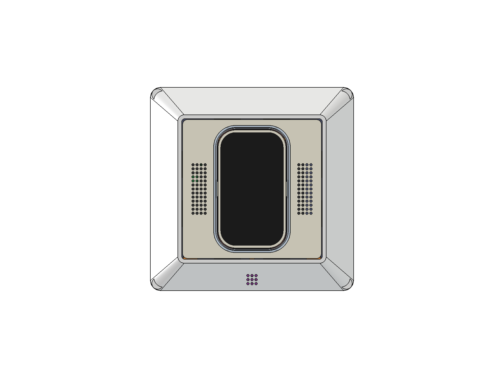
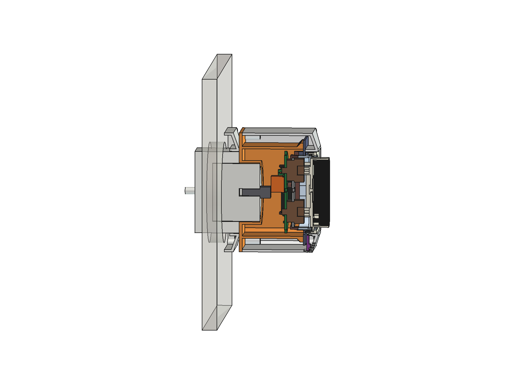
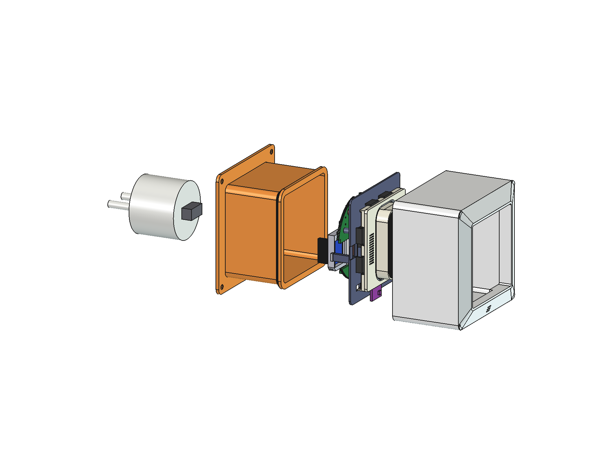

# RoomKey plug-in housing ("Steckdosen-RoomKey") — concept v0.1

> **DRAFT / WIP, concept only (2026-10-27, branch `plug`). AI-assisted design. Not printed, not tested, nothing
> certified.**
> - The RoomKey stays a **SELV-only (class III) device**. 230 V exists only **inside an unmodified, certified plug-in
>   USB charger**. The printed housing only holds that charger; nobody opens it, wires it or changes it.
> - The charger's own plug goes straight into the socket through the housing's back plate. No mains wiring in this
>   repository, no mains parts from it.

The owner's brief: the whole RoomKey as **one device that plugs into a SCHUKO socket**, **as flat on the wall as
possible**, with **the same front as the flush-mounted RoomKey**. Chosen: one 1-gang frame size (80.5 × 80.5, Jung
AS 500), **charger behind** the RoomKey; the charger was left to the design ("pick one").

## Stack-up (depth d behind the plate front)

| d (mm) | what | why |
|---|---|---|
| −8.0 | key glass | the unchanged key stack (8 mm proud) |
| −1.0 | frame rim | practice frame, Jung AS 500 profile |
| 7.7 / 7.8–9.0 | G1 frame tunnel end / insert flange | G1 holds the flange from the front (0.1 play) |
| 9.0 | G2 cup rim | presses the flange from behind: **no box screws** |
| 30.81 | key wires' U-loop, back end | deepest insert part on the axis (`loop_up()`) |
| 31.31–38.31 | USB-A plug body | 0.5 behind the loop; shell 12 deep in the charger's port |
| 38.31 | charger front face | rests on the sleeve's front lip |
| 52.31 | socket face = housing back face | charger: 14 out of the socket, 18 in the recess |

**60.3 mm from the key glass to the socket face** (53.3 from the frame rim). On a Jung AS 500 SCHUKO socket (face
≈ 10 mm in front of the wall) the key glass is ≈ 70 mm from the wall. 175 g, centre of mass 21 mm in front of the socket
face → 0.036 N·m on the socket (IEC 60950-1 §4.3.6 / IEC 62368-1 §4.7 allow 0.25 N·m for direct plug-in equipment).

## Charger

**revolt PX-8884** (Pearl, 9.99 €, EAN 4022107346085): round, Ø39 × 51 mm with pins, 5 V 2.1 A USB-A, contour plug
(Ø4.8 pins), 0.06 W at no load. It sits **18 mm deep in the socket recess** and stands out only 14 mm — the flattest
plug-in charger found. Its round body in the recess also carries the whole device sideways.
Open: the shop lists no GS / TÜV mark (CE only); the port's exact place and size need the real part.
Flatter options (a flat charger with the port on its side edge) would save ≈ 4–8 mm; none with known dimensions and a
safety mark was found yet.

## Parts

| | part | print | notes |
|---|---|---|---|
| G1 | frame + side walls (`plug_shell`) | back down, supports **inside** (frame face, tunnel) | frame tunnel lengthened to d 7.7 = flange stop, open at the bottom centre for the SHT31-D; 4 corner bosses (M3 pilot Ø2.6) |
| G2 | box (`plug_box`) | back down, no supports (widest ceiling 4.9) | back plate 2.0, charger sleeve with 8 crush ribs (0.1 press fit) and a front lip, square cup (inner 59 × 59) whose rim backs the flange, notch for the radar's plug |
| — | insert | unchanged kit, PCB build | the box screws and load plates are not used |

4 × M3 × 12 countersunk (ISO 10642) through the back plate into G1 — hidden on the socket.

## Materials (recommendation 2026-10-27, Bambu A1 = open printer)

| part | material | why |
|---|---|---|
| G2 box + charger sleeve | **PETG UL94 V-0**, black (Prusament PETG V0 Jet Black; Spectrum PET-G FR V0) | touches the charger; hidden; prints like PETG (230 °C / 80 °C) |
| chassis (3), switch plate, radar tray | PETG V-0, black | as insert-design §10 already demands for the chassis |
| G1 frame + shell | ivory PETG from the plate's spool (or PETG V0 Natural if its shade matches) | visible, must match the plate; the charger does not touch it |
| plate, key, collar | as before (ivory + black core + natural glow rim, PETG, AMS); collar optionally clear PCTG | the glow rim must fuse with the plate → PETG |
| new: grip ring in the sleeve, foot ring on the back plate | TPU 95A | holds the charger by spring force (crush ribs in brittle V-0 PETG break or relax); protects the socket face |

The four corner screws go into M3 heat-set inserts (V-0 PETG is more brittle than plain PETG). The housing runs ≈ 5–10 K
above room temperature (≈ 1.4 W inside), so PETG (Tg ≈ 80 °C) has margin; PLA (Tg ≈ 55–60 °C) creeps at the press fit
and the screws. Not used: PLA, carbon/metal/graphite fills (conductive beside the plug pins, they damp the 24 GHz radar
and Wi-Fi), wood/stone fills, ABS/ASA/PC on the open A1 (warping). Bambu PC FR (V-0, also white) would be the best
material but needs an enclosed printer. Prusament's UL card covers prints on Prusa printers only: on the A1 the parts
are V-0 material, not certified parts.

## Assembly

1. Kit insert (without the plate) from behind into G1: its rims go into the frame tunnel, the flange onto the stop.
2. SHT31-D into its pocket under the frame's bottom border, plug it into J9.
3. Solder the USB-A plug's VBUS and GND (2 × 0.5 mm², ≈ 70 mm) to hub J1.
4. Plug it into the charger; press the charger into G2's sleeve from behind (wires fold into the cup).
5. G2 into G1 from behind, 4 screws. Plate onto the deck from the front.

## Open

- Buy the charger and measure it: body Ø (front / in the recess), length, the port's place, size and orientation.
- The radar's plug ends 0.26 mm beside the charger's front edge: check with the real charger.
- Socket height: at 30 cm (DIN 18015-3 socket zone) the display is at knee height; sockets next to a door at switch
  height (105 cm) suit RoomKey.
- Temperature reading: the charger and the RoomKey warm the housing; the SHT31-D sits at the front bottom, the furthest
  point from the charger — check against a reference thermometer.

## Files

`hardware/cad/insert_params.py` §8 (`PLUG_*`, `plug_depths()`), `plug_lib.py`, `make_plug.py` (headless build + checks),
`view_plug.py` (FreeCAD GUI: `plug-v0.1_ansicht.FCStd`, `PLUG_RENDER=1` renders the images). Outputs in
`hardware/models/plug*`.
